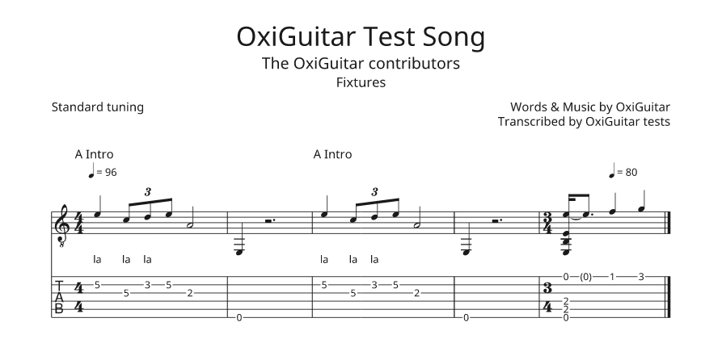

# oxiguitar-midi-file

The MIDI file plugin for [OxiGuitar](https://github.com/mateusrdp/oxiguitar), a free, open-source guitar tablature and score viewer, editor and player for Windows, macOS and Linux. With it OxiGuitar opens Standard MIDI Files, from a sequencer, a notation program, a MIDI guitar or a karaoke collection, and saves songs as MIDI files any program can play.

It is not the plugin that makes OxiGuitar's sound: that one is [oxiguitar-midi](https://github.com/mateusrdp/oxiguitar-midi), which plays SoundFonts, DLS and SFZ sound sets. This one only reads and writes files.

| Plugin file | Id | Reads | Writes |
| --- | --- | --- | --- |
| `midi-file.oxp` | `oxiguitar.midi-file` | MIDI files (.mid, .midi, karaoke .kar) and RIFF MIDI files (.rmi) | MIDI files (.mid) |

**Opening.** A MIDI file holds the times notes were played, not note values, so OxiGuitar puts every note on a grid: each beat of each track picks the one that fits its notes best, straight down to a 32nd or triplets, and a note a little early or late still lands on its beat. Notes that ring across a bar line, or past the next note, become tied notes, so what plays is what the file played. Tempo, time and key signatures, markers and lyrics (karaoke files' too) come along. General MIDI guitars and basses open as tablature, fingered by OxiGuitar as the file opens; every other pitched track is fingered too but shows notation only until you turn its tablature on in the Track tab; channel 10 opens as drums. A guitar recorded with a channel for each string, as MIDI guitars send it, opens as one track.

**Saving.** A MIDI file is written as OxiGuitar plays the song: repeats and jumps played out, swing, strums and dynamics as you hear them, bends, slides, the whammy bar and vibrato as pitch bend (each string on a channel of its own, where the 16 MIDI channels allow, so a bend moves only its string), palm mutes, dead notes, harmonics and slaps as OxiGuitar's MIDI sound plugin plays them. OxiGuitar tells you first what a MIDI file can't hold: the notation as written, and the strings and frets.



The picture is [`fixtures/oxiguitar-test.mid`](fixtures/oxiguitar-test.mid) opened in OxiGuitar: OxiGuitar's own test song saved by this plugin, its repeat played out, the triplet, the tie and the lyrics read back, the frets found again as it opened.

The file type is decided from the file's contents, never from its extension: OxiGuitar recognises a MIDI file by the `MThd` at its start, and a RIFF MIDI file by `RMID` in its header. It needs OxiGuitar 0.18 or later (plugin interface 1.7).

[docs/design.md](docs/design.md) says what is read and written and what is left out, and why.

## Install

Every [release](https://github.com/mateusrdp/oxiguitar-midi-file/releases) holds a zip per system (Linux x86_64 and ARM64, Windows x86_64 and ARM64, macOS), a `.deb` and an `.rpm` for Linux, a per-user installer for Windows (no administrator needed), a `.pkg` for macOS, and a `SHA256SUMS` file. The OxiGuitar manual's [install page](https://mateusrdp.github.io/oxiguitar/installing.html) says which one to use and how to keep plugins updated through your package manager.

You can also copy `midi-file.oxp` from a zip into OxiGuitar's plugin folder by hand ([Settings and plugins](https://mateusrdp.github.io/oxiguitar/plugins.html)).

Found a file it reads wrongly? Please [open an issue](https://github.com/mateusrdp/oxiguitar-midi-file/issues/new) with the file if you can share it, and the program that wrote it.

## Build and test

Rust 1.99 or later from [rustup](https://rustup.rs). The plugin SDK, the score model and the player come from OxiGuitar's repository by git (plugin interface 1.7); nothing of OxiGuitar's is on crates.io. The files themselves are parsed and written with the [midly](https://crates.io/crates/midly) crate.

```sh
cargo test                  # the reader, the writer, and the plugin as an .oxp file
./build-oxp.sh              # dist/midi-file-VERSION-SYSTEM-ARCH.oxp
```

`cargo test` reads files made in the tests event by event as a player would record them, writes what it read and reads it back, then builds the plugin as the `.oxp` file we ship and checks it through OxiGuitar's own plugin host (the contract suite of `oxiguitar-plugin-test`). With MIDI files of a private collection in `corpus/files/` (never committed), `cargo test --test corpus` round-trips each of them. [CONTRIBUTING.md](CONTRIBUTING.md) has the rest of the rules.

What is where:

- `src/read.rs`: a MIDI file into OxiGuitar's score, quantised. `src/write.rs`: OxiGuitar's player timeline into a MIDI file.
- `src/instruments.rs`: which tracks are guitars, basses, drums or anything else, and General MIDI's instrument names. `src/text.rs`: texts in UTF-8 or Latin-1.
- `fixtures/`: our own MIDI file.
- `fuzz/`: fuzz targets for the reader and the writer ([fuzz/README.md](fuzz/README.md)).

## Releases

The maintainer releases with the Release button in [oxiguitar-packages](https://github.com/mateusrdp/oxiguitar-packages): it bumps the version, merges `develop` into `main` and tags it. [`release.yml`](.github/workflows/release.yml) then builds the plugin for every system with the packages' reusable plugin-release workflow, makes the packages and a draft release; publishing the draft starts [`publish.yml`](.github/workflows/publish.yml), which tells the package repositories. Every pull request gets the same builds as test builds, kept for 14 days under its Release run.

## Licence

GPL-3.0-or-later. See LICENSE.
Contributions are welcome under the same terms; see
[CONTRIBUTING.md](CONTRIBUTING.md).
