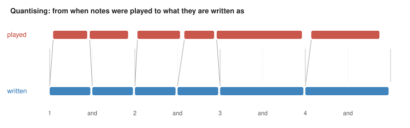

# MIDI file plugin

This plugin lets OxiGuitar open and save Standard MIDI Files, the `.mid` files that sequencers, notation programs, MIDI guitars, karaoke collections and almost every music program read and write. It turns a MIDI file into a score you can read, play and edit, and turns a score into a MIDI file you can take anywhere.

It reads `.mid`, `.midi`, `.kar` (karaoke) and RIFF MIDI (`.rmi`) files, and writes `.mid`. It only handles files. The plugin that makes OxiGuitar *sound* is a different one, the MIDI sound plugin.

## What's in a MIDI file

A MIDI file is a recording of a performance, not a score. It doesn't say "a quarter note E on the 4th beat"; it says "at 1.98 seconds, start the note with key 64, this loud, on channel 1", and later "at 2.41 seconds, stop it". Along with the notes it holds the tempo, time and key signatures, instrument numbers (General MIDI), markers and lyrics. Any program can play it back, which is why the format has lasted since the 1980s, but it has no idea of bars, note values, strings or frets.

So opening one means *transcribing* it, which is what a musician does by ear:

- **Quantising.** Real players are never exactly on the beat. The plugin lays a grid over each beat (halves, quarters, eighths, sixteenths, triplets) and moves each note to the nearest line, picking for each beat the simplest grid that fits what was played. A slightly late sixteenth stays a sixteenth.
- **Note values.** From where notes start and end on that grid, it writes the durations: plain, dotted, tied and triplets.
- **Strings and frets.** A MIDI file only knows pitches. OxiGuitar works out a fingering for guitar and bass tracks as the file opens. A MIDI guitar that sends one channel per string opens as one track with the strings it really played.

The grid is a very good guess, not a certainty: check the result before you rely on it, especially on swung or rubato playing.

## Saving

Saving a MIDI file goes the other way, and it is simpler: the plugin writes exactly what OxiGuitar would play, note by note. Repeats are played out, and bends, slides, vibrato and the whammy bar become pitch bend. What you hear in OxiGuitar is what the file holds. What a MIDI file can't hold (the notation as written, the strings and frets, the fingering) is lost, and OxiGuitar says so before saving. Save a MIDI file to play the song elsewhere, not to keep the score.
