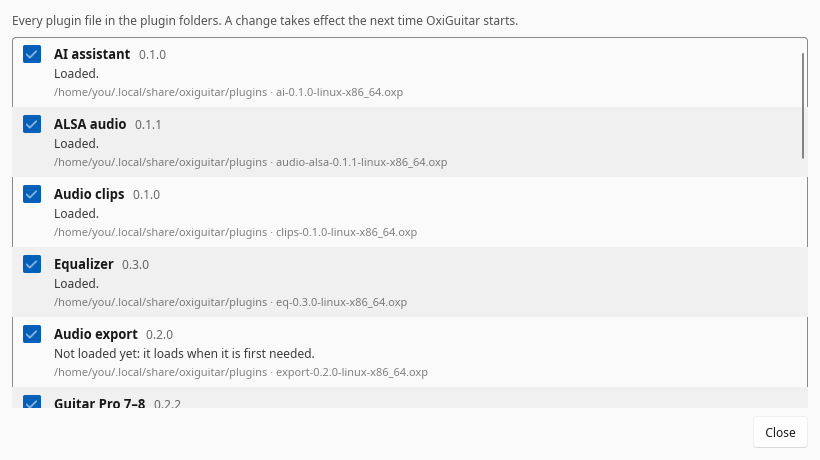

# How to use it

## Check it is installed

**Tools → Plugins…** lists every plugin OxiGuitar found, with its version, and lets you switch any of them off:

## Open and save

- **Open**: **File → Open…** and pick a `.mid`, `.midi`, `.kar` or `.rmi` file, or double-click one if your system links the file type to OxiGuitar. OxiGuitar looks inside the file to decide which plugin reads it; the extension doesn't matter.
- **Save**: **File → Save As…** and pick MIDI (`.mid`) as the format. If the format can't hold everything in your score, OxiGuitar says what would be lost before it saves, and you can keep the rest in the `.oxg` file beside it.
- **The import log**: anything the MIDI file plugin couldn't bring across is listed in the footer at the bottom of the window when the file opens.

## What you can do with it

- Open a MIDI file as a score you can read and edit. Notes are placed on a grid, so a note a little early or late still lands on its beat. Tempo, time and key signatures, markers and lyrics come along, karaoke lyrics too.
- Open a recording from a MIDI guitar. A guitar sent one channel per string opens as one track, with the frets worked out.
- Save a song as a MIDI file to use in a sequencer or to play anywhere. Repeats are played out, and bends, slides, vibrato and the whammy bar are written as pitch bend.

General MIDI guitars and basses open as tablature. Channel 10 opens as drums. OxiGuitar warns you before saving about what a MIDI file can't hold, such as the notation as written and the strings and frets.
